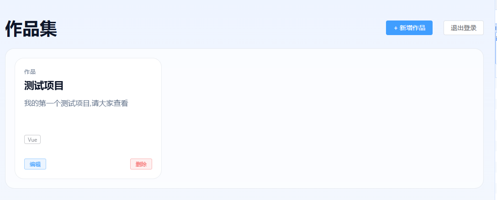

# 🚀 Personal Portfolio & Lightweight API

<p align="center">
  <a href="https://guohy.online" target="_blank">
    
  </a>
</p>

<div align="center">

[](https://nodejs.org/)
[](https://www.typescriptlang.org/)
[](https://expressjs.com/)
[](https://www.prisma.io/)
[](https://jwt.io/)
[](https://vuejs.org/)

</div>

一个基于 **Vue 3 + Node.js + Prisma** 构建的全栈个人作品集系统。包含无状态的 RESTful API 后端，以及响应式前端界面。具备完整的用户认证、作品 CRUD、防越权控制、AI 摘要生成及生产级防御能力。

🌐 **在线演示**: [https://guohy.online](https://guohy.online) _(账号密码请咨询作者或自行注册)_

## 📸 界面预览



## ✨ 核心特性

- **🔐 安全闭环**：基于 JWT 的无状态鉴权 + Bcrypt 密码哈希，配合 Express Rate Limit 实现防暴力破解与防恶意注册。
- **🛡️ 越权拦截**：利用 Prisma 关系模型实现数据隔离，用户仅能修改/删除自己创建的记录（IDOR 防护）。
- **🤖 AI 辅助生成**：集成大模型 API，支持根据标题和技术栈一键生成项目摘要（含超时降级与错误处理）。
- **📦 生产级防御**：全局统一的 `{ error: { code, message } }` 错误模型，全链路 Zod 数据校验。
- **🚀 自动化部署**：提供完整的 PM2 + Nginx 生产部署方案与 SQLite 定时备份脚本。

## 🧱 技术栈

**后端**: Node.js 20+, TypeScript, Express 5, Prisma ORM, SQLite, Zod, JWT, bcryptjs, OpenAI SDK
**前端**: Vue 3, Vite, Vue Router, 原生 Fetch 封装 (含拦截器)
**部署**: Ubuntu, Nginx, PM2, Certbot (HTTPS)

## 🏗️ 工程化亮点 (Engineering Highlights)

- **经典分层架构**：`Router -> Controller -> Service -> Prisma`，业务逻辑与 HTTP 协议解耦，便于后期迁移至微服务或切换数据库。
- **严格的测试门禁**：使用 `node:test` 编写集成测试，覆盖主流程与鉴权边界（8 个测试用例，100% 通过），配置独立的 `test.db` 实现测试环境隔离。
- **环境隔离**：利用 `.env` 区分开发（`dev.db`）与生产（`prod.db`），敏感配置零硬编码。
- **优雅的降级处理**：AI 服务异常、外部接口超时均不会影响核心 CRUD 链路，前端具备完善的 Toast 与 Loading 兜底状态。

## 📁 项目结构

```text
my_site_service/
├─ docs/
│  ├─ API.md              # 详细接口文档
│  └─ DEPLOYMENT.md       # 生产部署指南 (Nginx/PM2/SSL)
├─ prisma/
│  ├─ schema.prisma       # 数据模型定义
│  └─ migrations/         # 数据库迁移历史
├─ src/
│  ├─ app.ts              # Express 实例装配
│  ├─ index.ts            # 启动入口 & 环境校验
│  ├─ controllers/        # 控制层 (处理 HTTP 请求/响应)
│  ├─ services/           # 业务逻辑层 (校验/鉴权/AI)
│  ├─ schemas/            # Zod 校验规则
│  ├─ routes/             # 路由挂载与限流
│  ├─ middlewares/        # 鉴权与全局错误捕获
│  └─ utils/              # Prisma 单例与脱敏日志
├─ tests/                 # 集成测试用例
└─ package.json
```
